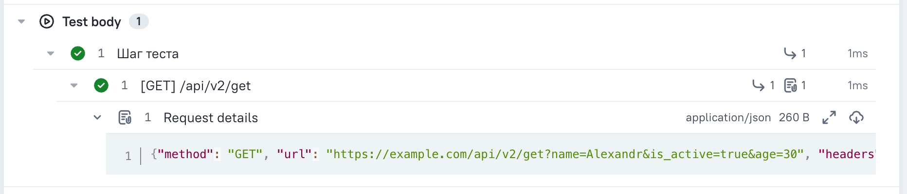
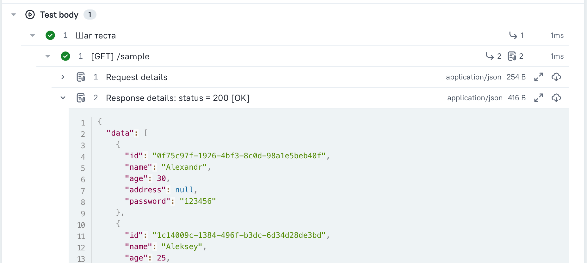
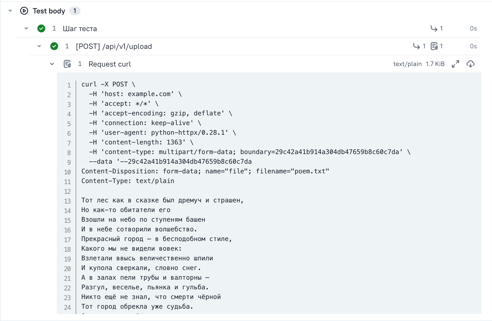

# Опции для интеграции HTTP-клиента с Allure

[](https://pypi.org/project/cloudru-qa-http-client-allure/)
[](https://pypi.org/project/cloudru-qa-http-client-allure/)
[](https://github.com/cloud-ru-tech/qa-libraries/blob/master/LICENSE)

Библиотека добавляет [HTTP-клиенту](https://github.com/cloud-ru-tech/qa-libraries/tree/master/packages/http-client) опции, которые оформляют каждый запрос как отдельный шаг Allure и прикрепляют к нему данные запроса и ответа.

Нужна, чтобы в отчете об автотестах было видно, какие запросы ушли, с какими телами и что ответил сервис — без ручных вызовов `allure.step` и `allure.attach` в коде тестов.

- [Опции для интеграции HTTP-клиента с Allure](#опции-для-интеграции-http-клиента-с-allure)
  - [Установка](#установка)
  - [Скиллы для AI-агентов](#скиллы-для-ai-агентов)
  - [Быстрый старт](#быстрый-старт)
  - [Опции](#опции)
    - [`wrap_requests_in_steps`](#wrap_requests_in_steps)
    - [`wrap_requests_and_responses_in_steps`](#wrap_requests_and_responses_in_steps)
  - [Параметры](#параметры)
  - [Заголовки ответа](#заголовки-ответа)
  - [Маскирование секретов](#маскирование-секретов)
  - [Запрос в формате curl](#запрос-в-формате-curl)
  - [Асинхронный клиент](#асинхронный-клиент)
  - [Потоковые запросы](#потоковые-запросы)
  - [Разработка](#разработка)

## Установка

Требуется Python 3.13 или новее.

```shell
pip install cloudru-qa-http-client-allure
```

Библиотека импортируется как модуль `http_client_allure`.

## Скиллы для AI-агентов

В пакет включён скилл [`http-client-allure-usage`](https://github.com/cloud-ru-tech/qa-libraries/blob/master/.agents/skills/http-client-allure-usage/SKILL.md)
с примерами и правилами использования библиотеки для AI-агентов. Установите библиотеку
в окружение своего проекта, затем из его корня выполните (нужен [`uv`](https://docs.astral.sh/uv/)):

```shell
uvx library-skills install --skill http-client-allure-usage --yes
```

Для Claude Code добавьте `--claude`. Инструкции поставляются вместе с версией библиотеки.

## Быстрый старт

Передайте опцию в конструктор клиента — дальше ничего делать не нужно, все запросы попадут в отчет сами:

```python
from http_client import HttpClient
from http_client_allure import wrap_requests_and_responses_in_steps

client = HttpClient(
    "https://example.com",
    wrap_requests_and_responses_in_steps(),
)

client.get("/sample")
```

## Опции

### `wrap_requests_in_steps`

Оборачивает каждый запрос в шаг Allure и прикрепляет к нему данные запроса.



```python
from http_client import HttpClient
from http_client_allure import wrap_requests_in_steps

client = HttpClient("https://example.com", wrap_requests_in_steps())
```

В шаге видна длительность запроса. Если сервис не ответил — оборвалось соединение или вышел таймаут — шаг все равно появится в отчете и будет помечен упавшим.

### `wrap_requests_and_responses_in_steps`

То же самое, но к шагу дополнительно прикрепляются данные ответа.



```python
from http_client import HttpClient
from http_client_allure import wrap_requests_and_responses_in_steps

client = HttpClient("https://example.com", wrap_requests_and_responses_in_steps())
```

## Параметры

Обе опции принимают одинаковый набор параметров.

| Параметр | По умолчанию | Что делает |
|---|---|---|
| `show_host` | `False` | показывать хост запроса в заголовке шага |
| `show_query_params` | `False` | показывать query параметры в заголовке шага |
| `attach_request` | `True` | прикреплять данные запроса к шагу |
| `attach_response` | `True` | прикреплять тело ответа к шагу (только у `wrap_requests_and_responses_in_steps`) |
| `attach_response_headers` | `True` | прикреплять заголовки ответа к шагу (только у `wrap_requests_and_responses_in_steps`) |
| `serialize_request_to_curl` | `False` | прикреплять запрос в виде команды curl вместо JSON |
| `sanitize_keys` | `None` | ключи в формате [glom](https://glom.readthedocs.io/en/latest/), значения которых нужно скрыть |
| `use_default_sanitize_keys` | `True` | дополнять `sanitize_keys` списком секретов из `http_client` |
| `json_dumps_kwargs` | `None` | параметры [`json.dumps`](https://docs.python.org/3/library/json.html#json.dump) для отображения JSON |
| `max_attach_length` | `None` | максимальная длина вложения в символах, длинные вложения обрезаются |

## Заголовки ответа

Заголовки и тело ответа прикрепляются к шагу отдельными вложениями:

- `Response headers: status = 200 [OK]` — заголовки ответа с замаскированными секретами,
- `Response content` — тело ответа.

Отдельное вложение с заголовками видно и тогда, когда тела нет вовсе — например у `204 No Content` — и у потокового ответа, тело которого в отчет не выгружается.

Вложения независимы, поэтому можно оставить только заголовки:

```python
wrap_requests_and_responses_in_steps(attach_response=False)
```

Статус ответа отображается только в имени вложения с заголовками: если выключить их через `attach_response_headers=False`, в отчете его не останется — заголовок шага строится до отправки запроса, статуса там взяться неоткуда.

## Маскирование секретов

Секреты в заголовках, query параметрах и телах скрываются автоматически: `authorization`, `cookie`, `x-api-key`, `token`, `password` и другие общеизвестные ключи.

Добавить свои ключи:

```python
wrap_requests_in_steps(sanitize_keys=["data.password", "items.*.token"])
```

Оставить только свои ключи, без набора по умолчанию:

```python
wrap_requests_in_steps(sanitize_keys=["data.password"], use_default_sanitize_keys=False)
```

## Запрос в формате curl

Чтобы запрос из отчета можно было скопировать и повторить в терминале:

```python
wrap_requests_in_steps(serialize_request_to_curl=True)
```



## Асинхронный клиент

Обе опции работают и с `AsyncHttpClient`, подключаются так же:

```python
from http_client import AsyncHttpClient
from http_client_allure import wrap_requests_and_responses_in_steps

async with AsyncHttpClient("https://example.com", wrap_requests_and_responses_in_steps()) as client:
    await client.get("/sample")
```

Одновременные запросы через `asyncio.gather` тоже поддерживаются: каждый получает свой шаг со своими данными. Длительность запроса в асинхронном шаге не отображается — в отличие от синхронного клиента.

## Потоковые запросы

`client.stream(...)`, `client.stream_request(...)` и `client.send(request, stream=True)` тоже попадают в отчет.

Тело потока в отчет не выгружается — вместо него будет заглушка `<streamed content>`. Если внутри шага вы сами прочитали тело, в отчет попадет оно.

## Разработка

Библиотека развивается в монорепозитории [qa-libraries](https://github.com/cloud-ru-tech/qa-libraries)
вместе с остальными библиотеками `cloudru-qa-*`. Нужны [`uv`](https://docs.astral.sh/uv/), GNU Make
и [`checkmake`](https://github.com/checkmake/checkmake),
команды запускаются из корня репозитория:

```shell
make sync                            # зависимости всех библиотек строго по uv.lock
make test-http-client-allure         # тесты этой библиотеки
make typecheck-http-client-allure    # mypy для этой библиотеки
make check                           # форматирование, ruff, mypy и тесты всего набора
```

Тесты прогоняются на Python 3.13 и 3.14. Окружение для другой версии создаётся отдельно:
`make sync test-http-client-allure PYTHON_VERSION=3.14`.

Демо-проект с настоящими запросами и собранным Allure-отчётом лежит в каталоге `examples/`.

Релиз выпускается git-тегом `http-client-allure/v<версия>`. Версия в теге должна совпадать
с версией в `packages/http-client-allure/pyproject.toml`.
