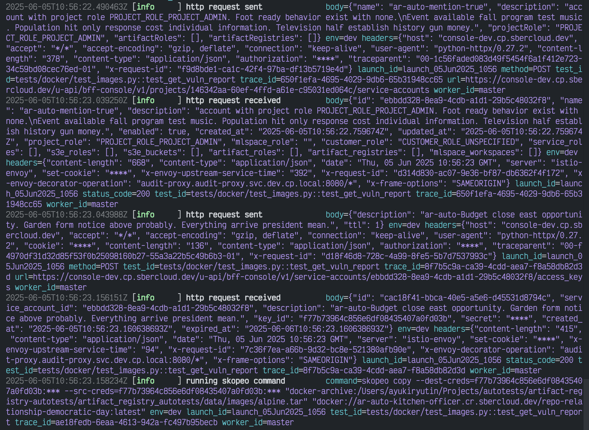

# Structured logs for the HTTP client

[](https://pypi.org/project/cloudru-qa-http-client-structlog/)
[](https://pypi.org/project/cloudru-qa-http-client-structlog/)
[](https://github.com/cloud-ru-tech/qa-libraries/blob/master/LICENSE)

English | [Русский](README.ru.md)

The `with_structlogger` option for the [HTTP client](https://github.com/cloud-ru-tech/qa-libraries/tree/master/packages/http-client)
logs all requests and responses through [structlog](https://www.structlog.org/en/stable/index.html).

The standard http-client logger puts the request in one text string. This option logs the method, URL,
headers, body, and other data as separate fields, visible in the console during debugging
and available for searching and filtering in collected logs.

- [Installation](#installation)
- [Skills for AI agents](#skills-for-ai-agents)
- [Usage](#usage)
- [Asynchronous client](#asynchronous-client)
- [Masking secrets](#masking-secrets)
- [Parameters](#parameters)
- [Development](#development)

## Installation

Requires Python 3.13 or later.

```shell
pip install cloudru-qa-http-client-structlog
```

Import the library as `http_client_structlog`. A compatible version of
[`cloudru-qa-http-client`](https://github.com/cloud-ru-tech/qa-libraries/tree/master/packages/http-client)
is installed with it.

## Skills for AI agents

The package includes the [`http-client-structlog-usage`](https://github.com/cloud-ru-tech/qa-libraries/blob/master/.agents/skills/http-client-structlog-usage/SKILL.md) skill
with examples and usage rules for AI agents. Install the library
in your project environment, then run this from its root (requires [`uv`](https://docs.astral.sh/uv/)):

```shell
uvx library-skills install --skill http-client-structlog-usage --yes
```

For Claude Code, add `--claude`. The instructions are shipped with the library version.

## Usage

Pass the option to the client constructor; logging is then automatic:

```python
import structlog

from http_client import HttpClient
from http_client_structlog import with_structlogger


class OrdersClient(HttpClient):
    def get_order(self, order_id: str):
        request = self.client.build_request("GET", f"/orders/{order_id}")
        return self.send(request)


with OrdersClient("https://api.example.com", with_structlogger(structlog.get_logger("orders"))) as client:
    client.get_order("42")
```

The request is logged as an `http request sent` event, the response as `http response received`.
A shared `trace_id` field links them.

Structured logs for automated tests can look like this:



## Asynchronous client

Use the same option without extra configuration:

```python
from http_client import AsyncHttpClient


class AsyncOrdersClient(AsyncHttpClient):
    async def get_order(self, order_id: str):
        request = self.client.build_request("GET", f"/orders/{order_id}")
        return await self.send(request)


async with AsyncOrdersClient("https://api.example.com", with_structlogger(logger)) as client:
    await client.get_order("42")
```

## Masking secrets

Fields with common secret names — `authorization`, `cookie`, `token`, `password`, `api_key`, and others
from `http_client.event_hooks.DEFAULT_SANITIZE_KEYS` — are masked **by default at every depth**,
including nested objects and array items.

Add your own fields with `sanitize_keys`. These are exact paths in
[glom](https://glom.readthedocs.io/en/latest/) format, applied to headers, query parameters,
and the JSON body. They extend the default list rather than replacing it:

```python
with_structlogger(
    logger,
    sanitize_keys=["user.password", "items.*.token"],
)
```

Write header names in lowercase: `"authorization"`, not `"Authorization"`.

Disable the default list explicitly with `use_default_sanitize_keys=False`.

## Parameters

| Parameter | Type | Purpose |
|---|---|---|
| `logger` | `structlog.stdlib.BoundLogger` | where to write |
| `sanitize_keys` | `Sequence[str] \| None` | glom paths to fields replaced with `****` |
| `json_indent` | `int \| None` | indentation width for JSON properties |
| `log_level` | `int \| None` | record level; `INFO` by default |
| `use_default_sanitize_keys` | `bool` | mask common secrets at every depth; `True` by default |

Set the level and indentation for the whole project with `http_client.configure_logging(...)`
or `HTTP_CLIENT_*` environment variables. Values passed to `with_structlogger` override shared settings.

## Development

The library is developed in the [qa-libraries](https://github.com/cloud-ru-tech/qa-libraries) monorepo
alongside the other `cloudru-qa-*` libraries. You need [`uv`](https://docs.astral.sh/uv/), GNU Make,
and [`checkmake`](https://github.com/checkmake/checkmake).
Run commands from the repository root:

```shell
make sync                              # install dependencies for all libraries from uv.lock
make test-http-client-structlog        # tests for this library
make typecheck-http-client-structlog   # mypy for this library
make check                             # formatting, ruff, mypy, and tests for the entire workspace
```

Tests run on Python 3.13 and 3.14. Create a separate environment for another version:
`make sync test-http-client-structlog PYTHON_VERSION=3.14`.

Publish a release with the git tag `http-client-structlog/v<version>`. The tag version must match
the version in `packages/http-client-structlog/pyproject.toml`.
