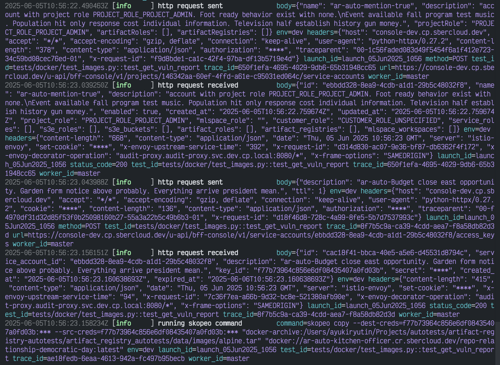

# Структурированные логи для HTTP-клиента

[](https://pypi.org/project/cloudru-qa-http-client-structlog/)
[](https://pypi.org/project/cloudru-qa-http-client-structlog/)
[](https://github.com/cloud-ru-tech/qa-libraries/blob/master/LICENSE)

[English](README.md) | Русский

Опция `with_structlogger` для [HTTP-клиента](https://github.com/cloud-ru-tech/qa-libraries/blob/master/packages/http-client/README.ru.md),
которая пишет все запросы и ответы через [structlog](https://www.structlog.org/en/stable/index.html).

Штатный логгер http-client складывает запрос в одну текстовую строку. Здесь метод, URL,
заголовки, тело и остальное уходят в лог отдельными полями — их видно в консоли при отладке
и по ним можно искать и фильтровать в собранных логах.

- [Установка](#установка)
- [Скиллы для AI-агентов](#скиллы-для-ai-агентов)
- [Использование](#использование)
- [Асинхронный клиент](#асинхронный-клиент)
- [Маскирование секретов](#маскирование-секретов)
- [Параметры](#параметры)
- [Разработка](#разработка)

## Установка

Требуется Python 3.13 или новее.

```shell
pip install cloudru-qa-http-client-structlog
```

Библиотека импортируется как модуль `http_client_structlog`. Подходящая версия
[`cloudru-qa-http-client`](https://github.com/cloud-ru-tech/qa-libraries/blob/master/packages/http-client/README.ru.md)
устанавливается вместе с ней.

## Скиллы для AI-агентов

В пакет включён скилл [`http-client-structlog-usage`](https://github.com/cloud-ru-tech/qa-libraries/blob/master/.agents/skills/http-client-structlog-usage/SKILL.md)
с примерами и правилами использования библиотеки для AI-агентов. Установите библиотеку
в окружение своего проекта, затем из его корня выполните (нужен [`uv`](https://docs.astral.sh/uv/)):

```shell
uvx library-skills install --skill http-client-structlog-usage --yes
```

Для Claude Code добавьте `--claude`. Инструкции поставляются вместе с версией библиотеки.

## Использование

Передайте опцию в конструктор клиента — дальше логируется всё само:

```python
import structlog

from http_client import HttpClient
from http_client_structlog import with_structlogger


class OrdersClient(HttpClient):
    def get_order(self, order_id: str):
        request = self.client.build_request("GET", f"/orders/{order_id}")
        return self.send(request)


with OrdersClient("https://api.example.com", with_structlogger(structlog.get_logger("orders"))) as client:
    client.get_order("42")
```

Запрос попадёт в лог событием `http request sent`, ответ — `http response received`.
Общее поле `trace_id` связывает их между собой.

Вот так могут выглядеть структурированные логи для автотестов:



## Асинхронный клиент

Опция та же, ничего дополнительно настраивать не нужно:

```python
from http_client import AsyncHttpClient


class AsyncOrdersClient(AsyncHttpClient):
    async def get_order(self, order_id: str):
        request = self.client.build_request("GET", f"/orders/{order_id}")
        return await self.send(request)


async with AsyncOrdersClient("https://api.example.com", with_structlogger(logger)) as client:
    await client.get_order("42")
```

## Маскирование секретов

Поля с типовыми именами секретов — `authorization`, `cookie`, `token`, `password`, `api_key` и другие
из `http_client.event_hooks.DEFAULT_SANITIZE_KEYS` — маскируются **по умолчанию и на любой глубине**,
включая вложенные объекты и элементы массивов.

Свои поля добавляйте через `sanitize_keys`. Это точные пути в формате
[glom](https://glom.readthedocs.io/en/latest/), они применяются к заголовкам, query-параметрам
и JSON-телу и дополняют список по умолчанию, а не заменяют его:

```python
with_structlogger(
    logger,
    sanitize_keys=["user.password", "items.*.token"],
)
```

Имена заголовков пишите строчными — `"authorization"`, а не `"Authorization"`.

Отключить список по умолчанию можно только явно: `use_default_sanitize_keys=False`.

## Параметры

| Параметр | Тип | Назначение |
|---|---|---|
| `logger` | `structlog.stdlib.BoundLogger` | куда писать |
| `sanitize_keys` | `Sequence[str] \| None` | glom-пути к полям, которые заменяются на `****` |
| `json_indent` | `int \| None` | ширина отступа при сериализации JSON-свойств |
| `log_level` | `int \| None` | уровень записи, по умолчанию `INFO` |
| `use_default_sanitize_keys` | `bool` | маскировать ли типовые секреты на любой глубине, по умолчанию `True` |

Уровень и отступ можно задать сразу для всего проекта через `http_client.configure_logging(...)`
или переменные окружения `HTTP_CLIENT_*`. То, что передали в `with_structlogger`, важнее общей настройки.

## Разработка

Библиотека развивается в монорепозитории [qa-libraries](https://github.com/cloud-ru-tech/qa-libraries)
вместе с остальными библиотеками `cloudru-qa-*`. Нужны [`uv`](https://docs.astral.sh/uv/), GNU Make
и [`checkmake`](https://github.com/checkmake/checkmake),
команды запускаются из корня репозитория:

```shell
make sync                              # зависимости всех библиотек строго по uv.lock
make test-http-client-structlog        # тесты этой библиотеки
make typecheck-http-client-structlog   # mypy для этой библиотеки
make check                             # форматирование, ruff, mypy и тесты всего набора
```

Тесты прогоняются на Python 3.13 и 3.14. Окружение для другой версии создаётся отдельно:
`make sync test-http-client-structlog PYTHON_VERSION=3.14`.

Релиз выпускается git-тегом `http-client-structlog/v<версия>`. Версия в теге должна совпадать
с версией в `packages/http-client-structlog/pyproject.toml`.
