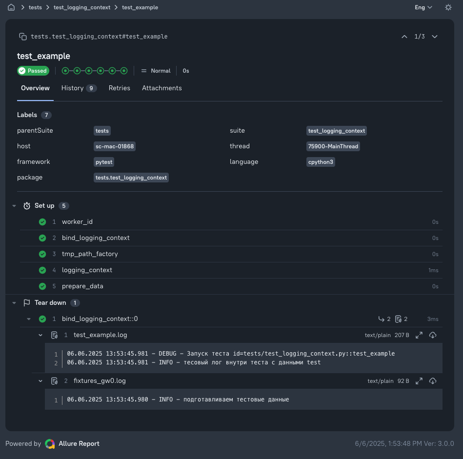

# Logging context for automated tests

[](https://pypi.org/project/cloudru-qa-logging-context/)
[](https://pypi.org/project/cloudru-qa-logging-context/)
[](https://github.com/cloud-ru-tech/qa-libraries/blob/master/LICENSE)

English | [Русский](README.ru.md)

A pytest plugin that writes each test's logs to a separate file and attaches them to
the Allure report.

Each test report should contain only that test's logs. With a regular
`FileHandler`, all tests append to one file, so attached logs include
messages from other tests. Parallel execution with
[`pytest-xdist`](https://pytest-xdist.readthedocs.io/en/stable/) also means
multiple processes writing to the same file. This plugin handles both cases.

- [Installation](#installation)
- [Skills for AI agents](#skills-for-ai-agents)
- [Quick start](#quick-start)
- [Demo projects](#demo-projects)
- [Where to find logs](#where-to-find-logs)
- [Settings](#settings)
- [Allure](#allure)
- [structlog](#structlog)
- [Other loggers and custom formats](#other-loggers-and-custom-formats)
- [Development](#development)

## Installation

Requires Python 3.13 or later.

```shell
pip install cloudru-qa-logging-context
```

Import the plugin as `logging_context`.

## Skills for AI agents

This library does not have its own skill yet. If your project uses other
libraries from this suite with [skills for AI agents](https://github.com/cloud-ru-tech/qa-libraries#skills-for-ai-agents),
select and enable them from your project root (requires [`uv`](https://docs.astral.sh/uv/)):

```shell
uvx library-skills
```

For Claude Code, add `--claude`.

## Quick start

The plugin loads automatically when installed, but **does nothing** until you set
a log directory. One line is enough:

```toml
# pyproject.toml
[tool.pytest.ini_options]
logging_context_dir = "logs"
```

A custom `conftest.py` is needed only for formatters that cannot be expressed as an ini string,
such as structlog or JSON (see below). For this test:

```python
import logging

import pytest

logger = logging.getLogger("test-logger")


@pytest.fixture
def user():
    logger.info("creating a user")
    yield {"id": 1}
    logger.info("deleting a user")


def test_login(user):
    logger.info("logging in as id=%s", user["id"])


@pytest.mark.parametrize("role", ["admin", "guest"])
def test_roles(role):
    logger.info("checking role %s", role)
```

running `pytest` produces:

```
logs/test_login.log
logs/test_roles[48fb048115c186ec].log
logs/test_roles[a81f6f2ab448a918].log
```

The plugin-generated headers retain their original Russian text:

```
--- logs/test_login.log
30.07.2026 15:21:40.776 - INFO - Запуск теста id=test_demo.py::test_login
30.07.2026 15:21:40.776 - INFO - creating a user
30.07.2026 15:21:40.778 - INFO - logging in as id=1
30.07.2026 15:21:40.780 - INFO - deleting a user

--- logs/test_roles[a81f6f2ab448a918].log
30.07.2026 15:21:40.790 - INFO - Запуск теста id=test_demo.py::test_roles[a81f6f2ab448a918] с параметрами {"role": "admin"}
30.07.2026 15:21:40.792 - INFO - checking role admin
```

Logs are attached to the Allure report automatically when `allure-pytest` is installed.



## Demo projects

[`examples/`](https://github.com/cloud-ru-tech/qa-libraries/tree/master/packages/logging-context/examples) contains two ready-to-run projects with the plugin enabled. Both use
the same sample shop client and tests, with fixtures, parametrization,
an intentionally failing test, and retries. Only their log formats differ:

| Example | Log file contents |
|---|---|
| [`examples/logging`](https://github.com/cloud-ru-tech/qa-libraries/tree/master/packages/logging-context/examples/logging) | Standard library `logging`, with lines such as `INFO shop.client товар SKU-TEA — Чай листовой` |
| [`examples/structlog`](https://github.com/cloud-ru-tech/qa-libraries/tree/master/packages/logging-context/examples/structlog) | `structlog`, using JSON Lines |

Run commands from the example directory, such as `packages/logging-context/examples/logging`:

```shell
uv sync
rm -rf logs
uv run pytest -v --clean-alluredir --alluredir=allure-results
npx allure awesome allure-results --single-file --output allure-report
```

Each test's logs remain in `logs/`, and the report is in `allure-report/index.html`. For parallel
runs with `pytest-xdist`, add `-n 4` to pytest. Building the report requires Node.js.

One test in each example fails intentionally, showing that a failing test's report contains
its own logs and that those logs explain the failure.

## Where to find logs

| File | Contents |
|---|---|
| `<test name>.log` | Test logs, including setup and teardown of all its fixtures |
| `fixtures_<worker_id>.log` | Logs outside tests, such as `pytest_sessionstart` or `conftest.py` imports |

Test parameters in filenames are replaced with hashes to keep names short and safe
regardless of parameter values. The parameters themselves appear in the first log line.

If a filename repeats, such as when retrying a failed test with
`pytest-rerunfailures` or when test functions in different modules share a name,
a numeric suffix is added. Each rerun attempt has its own file, so the report
shows the logs of the failed attempt:

```
logs/test_login.log     <- first attempt
logs/test_login.2.log   <- second attempt
logs/test_login.3.log   <- third attempt
```

Parallel runs add a worker identifier to filenames, so tests with the same function name
running on different workers do not write to the same file:

```
pytest            ->  logs/test_login.log
pytest -n 2       ->  logs/test_login.gw0.log
```

No log file is overwritten.

## Settings

Set all options in pytest configuration (`pyproject.toml`, `pytest.ini`, or `tox.ini`).

| Setting | Default | Description |
|---|---|---|
| `logging_context_dir` | — | Log directory. **The plugin is inactive until this is set.** Relative paths are resolved from `rootdir`. |
| `logging_context_launch_id` | — | Subdirectory within `logging_context_dir`, such as a CI run identifier. Must be a single path component. Can be overridden by a CLI option or environment variable; see below. |
| `logging_context_loggers` | root | Loggers to collect records from. Defaults to root, including third-party libraries. |
| `logging_context_level` | `INFO` | Minimum record level, as a name (`DEBUG`) or number. |
| `logging_context_format` | `%(asctime)s.%(msecs)03d - %(levelname)s - %(message)s` | Log line format. |
| `logging_context_date_format` | `%d.%m.%Y %H:%M:%S` | Timestamp format. |
| `logging_context_attach_allure` | `true` | Attach log files to the Allure report. |
| `logging_context_attach_fixtures_log` | `true` | Attach `fixtures_<worker_id>.log` to each test. |
| `logging_context_log_test_header` | `true` | Start each file with the test identifier and parameters. |
| `logging_context_params_indent` | `-1` | JSON indentation for parameters. `-1` means a single line. |

Collect logs only from your own loggers:

```toml
[tool.pytest.ini_options]
logging_context_dir = "logs"
logging_context_loggers = ["test-logger", "api-client"]
logging_context_level = "INFO"
```

By default, logs include third-party libraries (`httpx`, `urllib3`,
`playwright`), which often help explain test failures. To exclude this noise,
list your own loggers in `logging_context_loggers`.

The default mode also captures loggers with `propagate = False`, even if created
after the run starts. With `logging_context_loggers` set, however,
you must list these loggers explicitly; they are not discovered automatically.

Test parameters appear in the header as supplied. If they contain tokens or passwords,
disable the header: `logging_context_log_test_header = false`.

### Launch identifier

`launch_id` often comes from CI, so you can set it outside ini configuration:

```shell
pytest --logging-context-launch-id="$CI_PIPELINE_ID"
```

```shell
LOGGING_CONTEXT_LAUNCH_ID="$CI_PIPELINE_ID" pytest
```

Priority: command-line option → `LOGGING_CONTEXT_LAUNCH_ID` environment variable →
`logging_context_launch_id` in ini. Logs are stored in `<logging_context_dir>/<launch_id>/`.

## Allure

No extra setup is needed: when `allure-pytest` is installed and `--alluredir` is set,
the plugin attaches the test log and fixtures log to each test. Disable this with
`logging_context_attach_allure = false`, or disable only the fixtures log with
`logging_context_attach_fixtures_log = false`.

`allure-pytest` **also attaches its own** `log` attachment to each test.
To avoid duplicate log attachments, disable one using `--allure-no-capture` or
`logging_context_attach_allure = false`.

## structlog

Route `structlog` through standard library logging and set the formatter with the
`pytest_logging_context_configure`:

```python
# conftest.py
import structlog

structlog.configure(
    processors=[
        structlog.stdlib.add_logger_name,
        structlog.stdlib.add_log_level,
        structlog.stdlib.ProcessorFormatter.wrap_for_formatter,
    ],
    logger_factory=structlog.stdlib.LoggerFactory(),
    wrapper_class=structlog.stdlib.BoundLogger,
    cache_logger_on_first_use=True,
)


def pytest_logging_context_configure(handler):
    handler.setFormatter(
        structlog.stdlib.ProcessorFormatter(
            processor=structlog.processors.JSONRenderer(ensure_ascii=False),
            foreign_pre_chain=[
                structlog.stdlib.add_logger_name,
                structlog.stdlib.add_log_level,
            ],
        ),
    )
```

```toml
# pyproject.toml
[tool.pytest.ini_options]
logging_context_dir = "logs"
logging_context_log_test_header = false
```

`logging_context_log_test_header = false` keeps the file valid
JSON Lines.

The hook also accepts `config`; add it to the signature if needed. A complete working example
is in [`examples/structlog`](https://github.com/cloud-ru-tech/qa-libraries/tree/master/packages/logging-context/examples/structlog).

Test:

```python
import structlog

log = structlog.get_logger("test-logger")


def test_creates_shipment():
    log.info("shipment created", shipment_id=77)
```

`logs/test_creates_shipment.log`:

```json
{"shipment_id": 77, "event": "shipment created", "logger": "test-logger", "level": "info"}
```

Bound context is preserved:

```python
def test_retries_request():
    log = structlog.get_logger("test-logger").bind(request_id="req-51")
    log.warning("unexpected response")
```

```json
{"request_id": "req-51", "event": "unexpected response", "logger": "test-logger", "level": "warning"}
```

With `foreign_pre_chain`, third-party logs using standard library `logging` go to
the same file in the same format:

```python
def test_mixes_loggers():
    structlog.get_logger("test-logger").info("from structlog")
    logging.getLogger("legacy.client").warning("from stdlib")
```

`logs/test_mixes_loggers.log`:

```json
{"event": "from structlog", "logger": "test-logger", "level": "info"}
{"event": "from stdlib", "logger": "legacy.client", "level": "warning"}
```

## Other loggers and custom formats

Any logger that writes through standard library `logging` works. For `loguru`, use its
standard `InterceptHandler`; the rest is the same.

Use `pytest_logging_context_configure` for any formatter that cannot be expressed
as an ini string:

```python
# conftest.py
import json
import logging


class JsonFormatter(logging.Formatter):
    def format(self, record: logging.LogRecord) -> str:
        return json.dumps(
            {
                "time": self.formatTime(record),
                "level": record.levelname,
                "logger": record.name,
                "message": record.getMessage(),
            },
            ensure_ascii=False,
        )


def pytest_logging_context_configure(handler):
    handler.setFormatter(JsonFormatter())
```

## Development

This library is developed in the [qa-libraries](https://github.com/cloud-ru-tech/qa-libraries) monorepo
alongside the other `cloudru-qa-*` libraries. You need [`uv`](https://docs.astral.sh/uv/), GNU Make
and [`checkmake`](https://github.com/checkmake/checkmake);
run the commands from the repository root:

```shell
make sync                        # dependencies for all libraries from uv.lock
make test-logging-context        # tests for this library
make typecheck-logging-context   # mypy for this library
make check                       # formatting, Ruff, mypy, and tests for the whole suite
```

All checks must pass without errors or warnings. Tests run on Python 3.13 and 3.14.
Each version uses a separate environment: `make sync test-logging-context PYTHON_VERSION=3.14`.

Create a release with the Git tag `logging-context/v<version>`. The tag version must match the version
in `packages/logging-context/pyproject.toml`.
